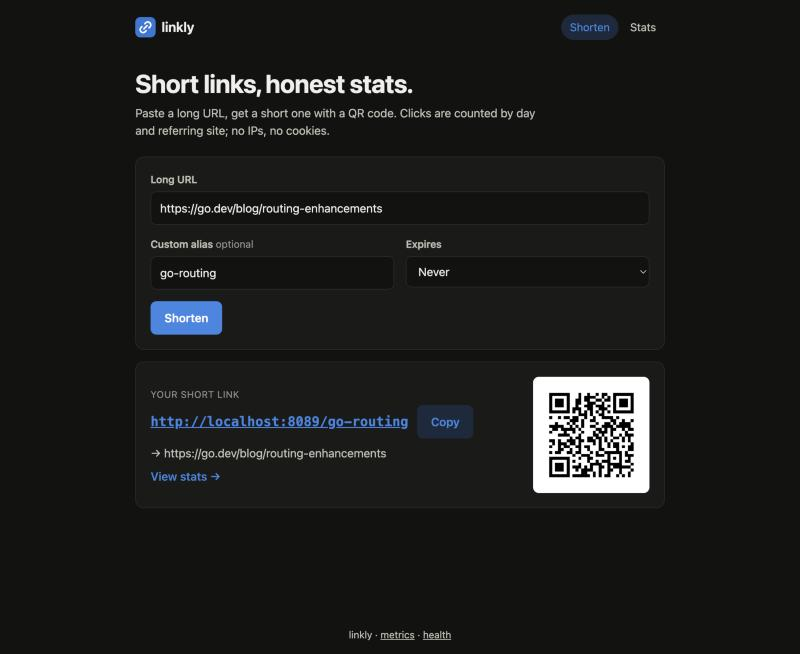
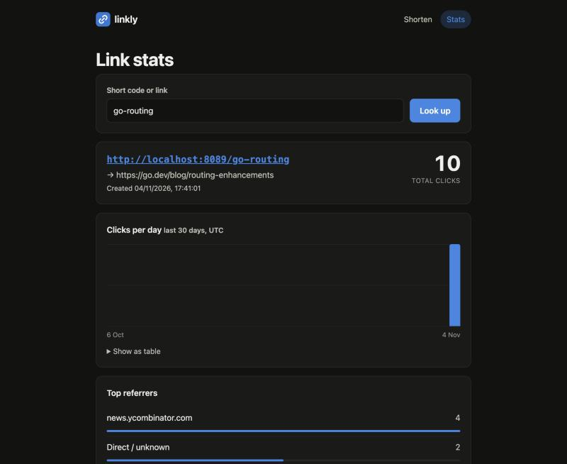

# linkly

A self-hosted URL shortener with click analytics that respect privacy. It is one static Go binary with an embedded web UI, backed by a single SQLite file.

Redirects take one indexed read. The redirect handler queues the click and returns; a background writer stores clicks in batches. The analytics keep the day and the referring host of each click, and never the visitor's IP address or the full referrer URL.



<details>
<summary>Stats view</summary>



</details>

## Features

- **Short links.** Generated codes are 7 random base62 characters from `crypto/rand`, drawn with rejection sampling so no character is favoured, and regenerated on collision. You can pick your own alias instead (3–32 characters from `[A-Za-z0-9_-]`; reserved words such as `api` and `healthz` are refused).
- **Expiry.** A link with an expiry time redirects until then and returns `410 Gone` afterwards. Its stats stay readable.
- **URL safety.** Targets must be absolute `http`/`https` URLs of at most 2048 bytes with a plain-ASCII host (internationalised domains are accepted in their punycode `xn--` form). URLs with credentials (`https://bank.com@evil.example`) are refused, and so are loopback, private, link-local and unspecified IP literals, numeric hosts in non-standard IPv4 form (`2130706433`, `0x7f000001`, `127.1`) and `localhost`. Links to linkly's own host, as named by `LINKLY_BASE_URL` or by the `Host` of the create request, are refused too. Loops through a name linkly does not know is its own cannot be detected when the link is created, so the redirect handler checks again: a target on the host the visitor just used (or the base URL's host) gets `508 Loop Detected` and is not counted. A chain through two names that are both unknown to linkly is not detected; each hop counts once, up to the client's redirect limit (about 20 in browsers, 30 in curl -L).
- **Analytics.** Each link reports its total clicks, clicks per day for the last 30 days, and its top 10 referring hosts.
- **QR codes.** A PNG for any short link, 64 to 1024 px.
- **Rate limiting.** A token bucket per client limits link creation. Idle buckets are evicted, `X-Forwarded-For` is used only when you opt in, and refused requests get a `429` with `Retry-After`.
- **Admin delete.** `DELETE` requires a bearer token of at least 16 bytes, compared in constant time. Deletion is disabled until a token is configured. After 5 wrong tokens a client gets `429` (with `Retry-After`) for every `DELETE`, right token or not, and earns one more attempt per minute.
- **Operations.** `/healthz` checks the database. `/metrics` serves the Prometheus text format. Logs are structured JSON (`log/slog`) with request IDs. The server recovers from handler panics, sets timeouts on the `http.Server`, and shuts down gracefully, flushing queued clicks first.
- **Web UI.** The UI needs no framework and no build step. It is responsive, follows the system's dark mode, and runs under a strict Content-Security-Policy.

## Quickstart

### With Go (1.27+)

```sh
go run ./cmd/linkly
# open http://localhost:8080
```

To enable deletion and listen on another port:

```sh
LINKLY_ADDR=:9000 LINKLY_BASE_URL=http://localhost:9000 \
LINKLY_ADMIN_TOKEN="$(openssl rand -hex 32)" go run ./cmd/linkly
```

### With Docker

```sh
docker compose up --build
# or
docker build -t linkly .
docker run -p 8080:8080 -v linkly-data:/data linkly
```

The image is a static binary on `distroless/static:nonroot`: it has no shell and runs as a non-root user (UID 65532). The database lives in the `/data` volume. `HEALTHCHECK` runs `linkly -healthcheck`, a built-in probe, because the image has no curl.

> The Dockerfile and compose file have not been built on the author's machine yet (no Docker there). The CI workflow builds the image and smoke-tests it.

## API

The full contract is in [`openapi.yaml`](openapi.yaml), which validates with `openapi-spec-validator`. Errors are JSON of the form `{"error": "...", "field": "...", "request_id": "..."}`.

| Method & path | Purpose | Success | Errors |
|---|---|---|---|
| `POST /api/links` | Create a link (rate limited) | `201` + `Location` | `400` invalid, `409` alias taken, `413`, `415`, `429` + `Retry-After` |
| `GET /{code}` | Redirect | `302` + `Location` | `404` unknown, `410` expired, `508` target is linkly itself |
| `GET /api/links/{code}` | Link info and stats | `200` | `404` |
| `GET /api/links/{code}/qr.png?size=256` | QR code PNG | `200 image/png` | `400` size, `404`, `410` |
| `DELETE /api/links/{code}` | Delete a link and its clicks | `204` | `401` bad token, `403` deletion disabled, `404`, `429` after repeated bad tokens |
| `GET /healthz` | Health, including a DB ping | `200 {"status":"ok"}` | `503` |
| `GET /metrics` | Prometheus metrics | `200` | |
| `GET /` | Web UI | `200` | |

```sh
# Create (generated code)
curl -s -X POST localhost:8080/api/links \
  -H 'Content-Type: application/json' \
  -d '{"url":"https://go.dev/doc/effective_go"}'
# {"code":"SvsEXkp","short_url":"http://localhost:8080/SvsEXkp","url":"https://go.dev/doc/effective_go",
#  "created_at":"2026-11-04T12:08:22Z","expired":false,"qr_url":"http://localhost:8080/api/links/SvsEXkp/qr.png"}

# Create with an alias and an expiry
curl -s -X POST localhost:8080/api/links -H 'Content-Type: application/json' \
  -d '{"url":"https://example.com/sale","alias":"flash","expires_at":"2026-12-31T23:59:59Z"}'

# Follow it (without following the redirect)
curl -si localhost:8080/flash | head -3
# HTTP/1.1 302 Found
# Cache-Control: no-store
# Location: https://example.com/sale

# Stats (abridged output from a local run after four clicks)
curl -s localhost:8080/api/links/SvsEXkp
# {..., "total_clicks": 4,
#  "clicks_by_day": [{"date":"2026-10-06","clicks":0}, ..., {"date":"2026-11-04","clicks":4}],
#  "top_referrers": [{"host":"news.ycombinator.com","clicks":2},{"host":"(direct)","clicks":1},{"host":"t.co","clicks":1}]}

# QR code
curl -s -o flash.png 'localhost:8080/api/links/flash/qr.png?size=300'

# Delete (needs LINKLY_ADMIN_TOKEN)
curl -si -X DELETE localhost:8080/api/links/flash -H "Authorization: Bearer $LINKLY_ADMIN_TOKEN"
```

## Configuration

Configuration comes only from environment variables. Invalid values stop startup, and every problem is reported at once.

| Variable | Default | Meaning |
|---|---|---|
| `LINKLY_ADDR` | `:8080` | Listen address |
| `LINKLY_DB` | `linkly.db` | SQLite database path (created if missing) |
| `LINKLY_BASE_URL` | `http://localhost:8080` | Public origin used to build short URLs, and the host that links may not point to |
| `LINKLY_ADMIN_TOKEN` | *(empty)* | Bearer token for `DELETE`, at least 16 bytes after trimming whitespace; empty disables deletion |
| `LINKLY_TRUST_PROXY` | `false` | Take the client IP from `X-Forwarded-For` (see below) |
| `LINKLY_RATE_LIMIT` | `1` | Link creations per second per client; `0` disables limiting |
| `LINKLY_RATE_BURST` | `10` | Bucket size: how many creations a client can make at once |
| `LINKLY_RATE_IDLE_TTL` | `10m` | Idle buckets are evicted after this (never before they have fully refilled) |
| `LINKLY_CLICK_BUFFER` | `10000` | Queue capacity; clicks beyond it are dropped and counted |
| `LINKLY_CLICK_BATCH` | `500` | Maximum clicks per write transaction |
| `LINKLY_CLICK_FLUSH_INTERVAL` | `1s` | Longest a click waits in the queue before it is written |
| `LINKLY_SHUTDOWN_TIMEOUT` | `10s` | Shared deadline for draining requests, flushing clicks and closing the DB |
| `LINKLY_LOG_LEVEL` | `info` | `debug`, `info`, `warn` or `error` |

## Architecture

```
                         ┌──────────────────────── httpapi ────────────────────────┐
 request ─► http.Server ─► request ID ─► security headers ─► observe (log + metrics)
            (timeouts)     └─► recover panics ─► ServeMux (Go 1.22 method/path patterns)
                                                   │
          ┌──────────────────┬─────────────────────┼───────────────────┬─────────────┐
          ▼                  ▼                     ▼                   ▼             ▼
   POST /api/links      GET /{code}        GET /api/links/{code}   DELETE …     /, /static/
   rate limiter ─┐      service.Resolve    service.Stats           bearer auth   embed.FS
                 ▼           │                  │                      │
            service.Create   │ 302 + Location   │ one read tx,          │
   validate URL / alias,     │                  │ three queries         │
   crypto/rand code, retry   ▼                  ▼                       ▼
                 └──────► store (SQLite, WAL): 1-conn write pool + N-conn read-only pool
```

### The click pipeline

```
GET /{code} ──► Recorder.Record(click)        non-blocking: select { case queue <- c: default: dropped++ }
                     │
                     ▼
        ┌──── buffered channel (LINKLY_CLICK_BUFFER) ────┐
        │                                                │
        ▼                                                │  on shutdown: close(queue),
  single worker goroutine                                │  worker drains the rest,
  batch until LINKLY_CLICK_BATCH or flush tick ──────────┘  flushes, then the DB closes
        │
        ▼
  store.InsertClicks: one transaction per batch
    · resolve each distinct code to a link id once (deleted links are skipped)
    · multi-row INSERT ... VALUES (?,?,?),(?,?,?),...
```

The shutdown order is fixed. `http.Server.Shutdown` waits for in-flight requests, because those requests may still enqueue clicks. The recorder then closes and drains its queue, and only then does the database close. One deadline covers all three steps.

## Design decisions and trade-offs

**Why SQLite.** A shortener reads far more than it writes, and its data set is small. SQLite in WAL mode lets readers proceed while a writer commits, and it removes a network hop and a whole service to operate. Writes are funnelled through a single-connection pool with `BEGIN IMMEDIATE` (`_txlock=immediate`), so writers queue inside `database/sql` and never fail with `SQLITE_BUSY`. Reads use a separate pool of `query_only` connections. The driver is `modernc.org/sqlite`, a pure-Go translation of SQLite: no cgo, a static binary, and a distroless image. The cost is that it is slower than the C library. Migrations are embedded SQL files applied in order at startup, each in its own transaction.

**Why record clicks asynchronously.** Writing a click inside the redirect would put a SQLite write lock on the hot path, so every redirect would wait for every other. Instead the handler does a non-blocking send to a buffered channel. When the buffer is full, the click is **dropped and counted** (`linkly_clicks_dropped_total`) rather than slowing the redirect. A redirect matters more than a perfect count. The trade-offs:

- Stats lag by up to `LINKLY_CLICK_FLUSH_INTERVAL`.
- A crash, as opposed to a graceful stop, loses whatever is still queued.
- Under sustained overload, the counts undercount.

The first load test made this concrete. At about 69k redirects/s the writer fell behind and 27% of clicks were dropped. Profiling showed the time going to SQLite's *statement sub-journal* being written to a temp file. Setting `temp_store=MEMORY`, plus multi-row INSERTs, fixed it. The same test now records every click (see [Benchmarks](#benchmarks)).

**What the analytics store.** Each click row stores a link ID, a Unix timestamp, and the referrer's *host*: `https://news.ycombinator.com/item?id=1` becomes `news.ycombinator.com`. A click row never contains an IP address, user agent, cookie, query string or path. Request logs don't record client IPs either. The rate limiter holds IPs in memory only, and only while a bucket is live. The `/64` grouping is described below. Clicks with no usable `Referer` are reported as `(direct)`. Parentheses cannot appear in a hostname, so this label never collides with a real host. `HEAD` requests (link checkers) are not counted.

**Rate limiting behind proxies.** By default the limiter keys on the TCP peer address, which a client cannot forge. Behind a reverse proxy, every request would then share the proxy's bucket, so `LINKLY_TRUST_PROXY=true` switches to `X-Forwarded-For`. In that mode linkly uses the **right-most** entry, the one your proxy appended. Entries further left were supplied by the client and are trivially spoofed. This assumes exactly one trusted proxy hop. Only enable it when linkly is unreachable except through that proxy, or anyone can pick their own key. IPv6 clients are keyed by their `/64`, because one host often controls a whole `/64`.

Buckets refill continuously, and idle buckets are swept every minute. A bucket is evicted only after it would have refilled completely. A full bucket is identical to a fresh one, so eviction never grants extra tokens.

**Other decisions.**

- **Routing.** Routes use Go 1.22+ `ServeMux` patterns with no framework. Metrics are labelled by *route pattern* (`GET /{code}`), never by raw path, so label cardinality stays bounded.
- **Admin token check.** Both the submitted token and the configured token are hashed with SHA-256 before `subtle.ConstantTimeCompare`, so the comparison does not reveal the token's length either.
- **Redirect caching.** Redirects send `Cache-Control: no-store`, so every click reaches the server and gets counted. The trade-off is that browsers and CDNs cannot cache redirects.
- **Metrics.** The Prometheus exposition code (counters, a histogram, function-backed gauges) is about 270 lines in `internal/metrics`, written here instead of pulling in `client_golang` and its dependency tree.

### Dependencies

| Module | Why |
|---|---|
| `modernc.org/sqlite` | SQLite without cgo, which keeps the binary static and lets the image be distroless. It brings its own transitive modules (`modernc.org/libc`, `memory`, `mathutil`, `golang.org/x/sys`, `google/uuid`, `dustin/go-humanize`, `mattn/go-isatty`, `ncruces/go-strftime`, `remyoudompheng/bigfft`), all needed by the translated C runtime. |
| `github.com/skip2/go-qrcode` | Small, widely used QR encoder with no dependencies of its own. Writing a correct QR encoder (Reed–Solomon, masking) is not where this project's value lies. |

Everything else (HTTP routing, logging, metrics, rate limiting, configuration) uses the standard library.

## Testing

```sh
make test     # go test -race ./...
make cover    # with coverage
make lint     # gofmt check, go vet, staticcheck
make bench
```

There are 71 test functions and 126 table-driven subtests, and all of them pass under `-race`. `go vet`, `gofmt -l` and `staticcheck` 2026.2.2 report nothing. Total statement coverage is **90.5%**:

| Package | Coverage | What is tested |
|---|---|---|
| `internal/ratelimit` | 97.9% | Refill timing, partial refill and caps on an injectable clock; eviction; TTL never shorter than refill; concurrency |
| `internal/analytics` | 97.3% | Flush on `Close`, batch sizing, ticker flush, never blocking when full, drop accounting, sink errors, close-vs-record races, referrer parsing |
| `internal/metrics` | 97.1% | Exact exposition output, escaping, histogram `le` semantics, concurrency |
| `internal/service` | 96.0% | Code generation (bias check, rejection sampling, collision retry, give-up), alias and URL validation tables, expiry rules, 30-day fill |
| `internal/httpapi` | 94.9% | End-to-end over `httptest`: create → redirect → stats; validation table; expiry → 410; 429 with `Retry-After`; `X-Forwarded-For` trust; delete with and without the token; QR PNG decoding; health, metrics, UI and CSP; request IDs; panic recovery |
| `internal/app` | 94.6% | Real server on a socket: clicks queued under a 1-hour flush interval reach the DB on graceful shutdown |
| `internal/config` | 90.3% | Defaults, overrides, aggregated errors |
| `internal/store` | 81.8% | Against a temp SQLite file: CRUD, conflicts, case sensitivity, stats queries, cascade delete, reopen and WAL, read-only pool, concurrent reads and writes, migration ordering |
| `cmd/linkly` | 45.2% | Flags and config errors (the serve path is covered through `internal/app`) |

## Benchmarks

All numbers come from an Apple M3 (8 cores, 16 GB) on macOS 26.6 with Go 1.27.3. The load generator ran on the same machine as the server, so the two competed for CPU. Expect different numbers on other hardware.

**HTTP load test.** [`hey`](https://github.com/rakyll/hey) ran three passes of 200,000 `GET /{code}` requests at 50 concurrent connections against the release binary. The server ran with default settings, including info-level JSON request logs written to a file. A 5,000-request warm-up came first.

| Run | Requests/s | p50 | p99 | Responses |
|---|---|---|---|---|
| 1 | 62,291 | 0.5 ms | 4.4 ms | 200,000 × 302 |
| 2 | 59,982 | 0.5 ms | 4.0 ms | 200,000 × 302 |
| 3 | 58,040 | 0.6 ms | 4.0 ms | 200,000 × 302 |

Afterwards, `/metrics` showed `linkly_clicks_recorded_total 605000` (all warm-up and test clicks), `linkly_clicks_dropped_total 0`, and a queue depth of 0. Before the statement-journal fix described above, a similar run at about 69k req/s dropped 67,044 of 250,012 clicks.

**Go benchmarks** (`make bench`):

| Benchmark | Result |
|---|---|
| `BenchmarkRedirect` (full middleware stack + SQLite lookup + click hand-off, `RunParallel`, 8 procs) | ~3.7–4.5 µs/op, 69 allocs/op |
| `BenchmarkRedirect` with `-cpu 1` | ~11 µs/op |
| `BenchmarkInsertClicks` (500-click batches, per click) | ~4.5–5.4 µs |
| `BenchmarkAllow` (rate limiter, parallel) | ~200 ns/op, 0 allocs |

The redirect benchmark discards logs, and it uses `httptest.ResponseRecorder` rather than a real socket.

## Project layout

```
cmd/linkly/            main: flags, env config, signal handling, -healthcheck probe
internal/app/          wiring and lifecycle (serve, graceful shutdown order)
internal/config/       LINKLY_* environment parsing and validation
internal/service/      business rules: URL/alias validation, code generation, expiry, stats shaping
internal/store/        SQLite: split pools, prepared statements, embedded migrations/
internal/analytics/    async click recorder (bounded queue + batching worker), referrer parsing
internal/ratelimit/    token buckets with injectable clock and idle eviction
internal/metrics/      minimal Prometheus text-format registry
internal/httpapi/      handlers, middleware, client-IP logic, embedded web/ UI
openapi.yaml           API contract
Dockerfile, compose.yaml, Makefile, .github/workflows/ci.yml
```

## Limitations and next steps

- **Single node.** SQLite and the in-memory rate limiter assume one process. Scaling out would need a shared store (Postgres) and a shared limiter (Redis, or limiting at the edge).
- **Clicks can be lost.** Clicks still queued during a crash, and clicks dropped under sustained overload, are not counted. The drops show up in metrics, but nothing replays them. A write-ahead spool, or sampling under load, would be the next step.
- **No link lookup cache.** Each redirect reads SQLite. A small LRU keyed by code, invalidated on delete, would raise throughput further.
- **One admin token.** There are no user accounts or per-link ownership. Anyone can create links, within the rate limit, and only the admin can delete them.
- **No abuse screening.** Targets are not checked against Safe Browsing or similar lists.
- **Fixed stats window.** Stats cover a fixed 30-day UTC window. There is no time-zone selection or CSV export.
- **One proxy hop.** `X-Forwarded-For` handling assumes exactly one trusted proxy. A configurable trusted-hop count or CIDR list would generalise it.
- **CI and Docker not yet run.** The Docker image and the CI workflow have not run yet. The Go test, lint and build steps they perform were all run locally.

## License

[MIT](LICENSE) © 2026 Samarth Jaiswal
